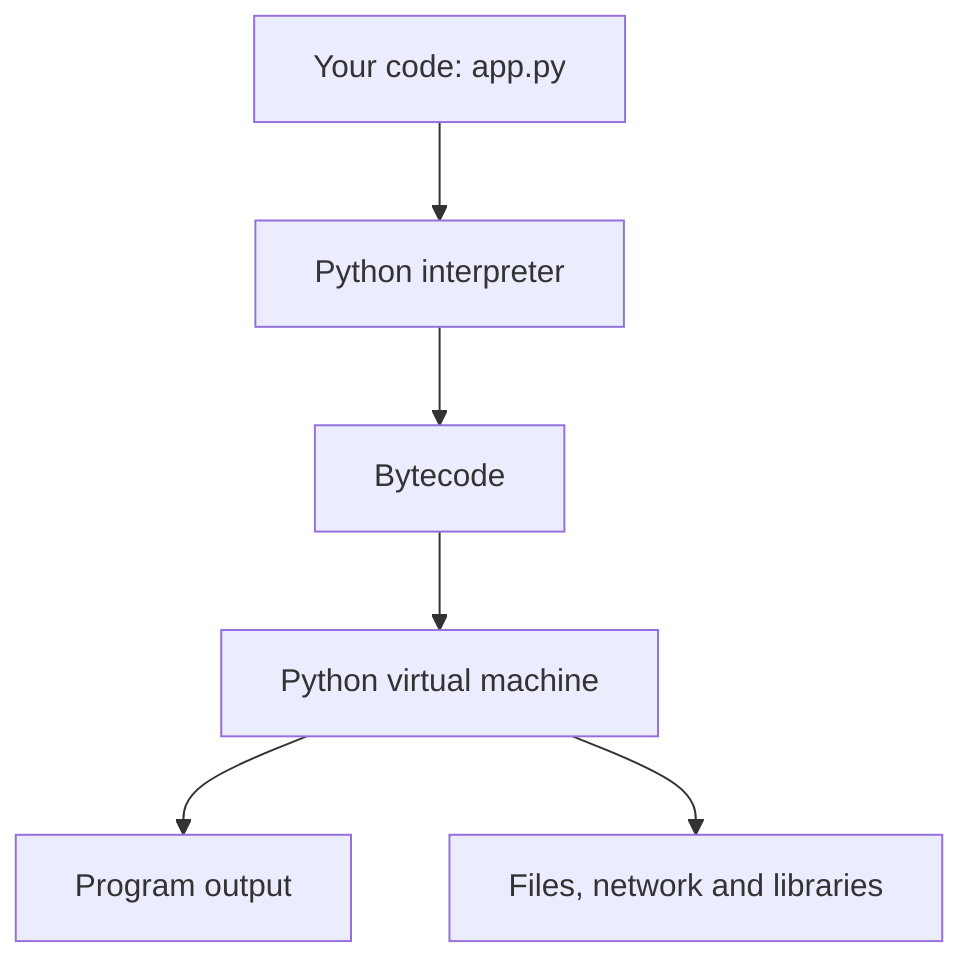
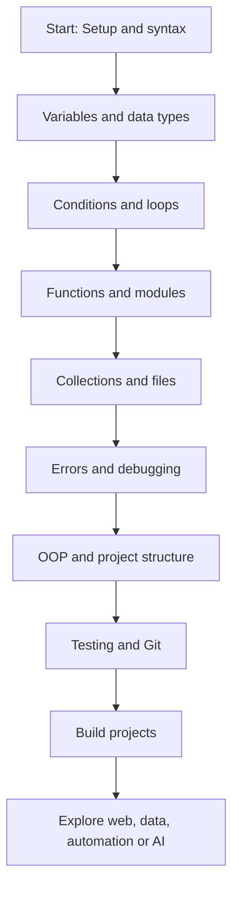
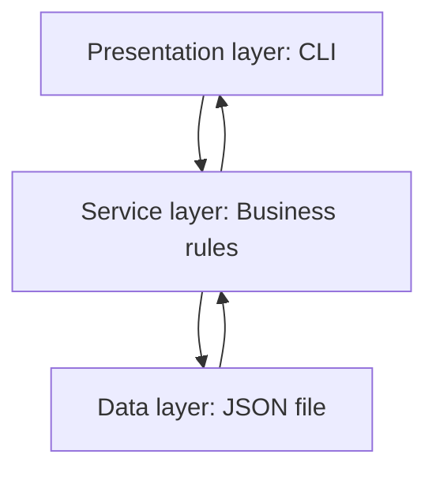

# Learn Python from Zero 🐍

A practical, beginner-friendly guide to learning Python, understanding how Python programs work, and organizing your first projects with clean architecture.

> **Who this is for:** Complete beginners. You do not need prior programming experience.
>
> **Goal:** Learn Python fundamentals and build a small, well-structured command-line application.

## Table of Contents

1. [What is Python?](#1-what-is-python)
2. [Install Python and Set Up Your Workspace](#2-install-python-and-set-up-your-workspace)
3. [How Python Works: Basic Architecture](#3-how-python-works-basic-architecture)
4. [Learning Roadmap](#4-learning-roadmap)
5. [Python Fundamentals with Examples](#5-python-fundamentals-with-examples)
6. [Functions, Modules, and Packages](#6-functions-modules-and-packages)
7. [Object-Oriented Programming (OOP)](#7-object-oriented-programming-oop)
8. [Project Architecture for Beginners](#8-project-architecture-for-beginners)
9. [Build Your First Structured Project: Task Tracker](#9-build-your-first-structured-project-task-tracker)
10. [Testing and Debugging](#10-testing-and-debugging)
11. [Best Practices](#11-best-practices)
12. [Four-Week Study Plan](#12-four-week-study-plan)
13. [Practice Challenges](#13-practice-challenges)
14. [Helpful Resources and Next Steps](#14-helpful-resources-and-next-steps)

---

## 1. What is Python?

Python is a general-purpose programming language known for readable syntax. You can use it for:

- **Automation:** Rename files, process spreadsheets, or automate repetitive tasks.
- **Web development:** Build APIs and websites.
- **Data analysis:** Clean, explore, and visualize datasets.
- **AI and machine learning:** Create intelligent applications.
- **Scripting and tools:** Build command-line utilities.

Your first Python program:

```python
print("Hello, World!")
```

Save this in a file named `hello.py`, then run:

```bash
python hello.py
```

> On some macOS and Linux installations, use `python3` instead of `python`.

## 2. Install Python and Set Up Your Workspace

1. Install a supported Python 3 version from [python.org/downloads](https://www.python.org/downloads/).
2. Install a code editor such as [Visual Studio Code](https://code.visualstudio.com/).
3. Open a terminal and verify your installation:

   ```bash
   python --version
   python -m pip --version
   ```

4. Create a workspace and a virtual environment:

   ```bash
   mkdir learn-python
   cd learn-python
   python -m venv .venv
   ```

5. Activate the environment:

   **Windows PowerShell**

   ```powershell
   .venv\Scripts\Activate.ps1
   ```

   **macOS / Linux**

   ```bash
   source .venv/bin/activate
   ```

6. Create and run `hello.py`:

   ```python
   name = input("What is your name? ")
   print(f"Welcome to Python, {name}!")
   ```

A **virtual environment** keeps each project's installed Python packages separate. If `python` is not found on macOS or Linux, use `python3` for installation and execution commands. On Windows, the `py` launcher is another option.

## 3. How Python Works: Basic Architecture

When you run a Python file, the Python interpreter reads your code, compiles it into bytecode (in standard CPython), and executes it in a virtual machine.



### The pieces explained

| Component | What it does |
| --- | --- |
| `.py` file | Stores Python source code written by you. |
| Python interpreter | Runs Python programs. |
| Bytecode | Internal instructions produced from source code in CPython. |
| Python virtual machine | Executes the instructions. |
| Standard library | Built-in modules for files, dates, JSON, testing, and more. |
| Third-party packages | Extra functionality installed through tools like `pip`. |
| Virtual environment | Isolates packages for an individual project. |

**Important:** This diagram describes the typical **CPython** implementation. Other Python implementations may work differently.

## 4. Learning Roadmap



| Stage | Topics | Mini-project |
| --- | --- | --- |
| 1. Basics | Printing, variables, input, types | Greeting program |
| 2. Logic | `if`, `for`, `while`, comparisons | Number guessing game |
| 3. Data | Lists, tuples, sets, dictionaries | Shopping list |
| 4. Reuse | Functions, imports, modules | Calculator |
| 5. Real-world work | Files, JSON, exceptions | Notes saver |
| 6. Structure | Classes, layers, testing | Task tracker |

## 5. Python Fundamentals with Examples

### Variables and data types

```python
name = "Alex"        # str: text
age = 21             # int: whole number
height = 1.75        # float: decimal number
is_student = True    # bool: True or False

print(f"{name} is {age} years old.")
print(type(height))
```

### Operators and conditions

```python
score = 78

if score >= 90:
    print("Excellent")
elif score >= 60:
    print("Passed")
else:
    print("Keep practicing")
```

Python uses **indentation** (commonly four spaces) to group statements.

### Loops

```python
for number in range(1, 6):
    print(number)

count = 3
while count > 0:
    print(count)
    count -= 1
```

### Lists and dictionaries

```python
languages = ["Python", "JavaScript", "Go"]
languages.append("Rust")
print(languages[0])

student = {"name": "Alex", "level": "beginner"}
print(student["level"])
```

### Input and simple error handling

```python
try:
    age = int(input("Enter your age: "))
    print(f"Next year you will be {age + 1}.")
except ValueError:
    print("Please enter a whole number.")
```

### Read and write files

```python
from pathlib import Path

file_path = Path("notes.txt")
file_path.write_text("Today I learned Python!\n", encoding="utf-8")
print(file_path.read_text(encoding="utf-8"))
```

## 6. Functions, Modules, and Packages

A **function** groups reusable logic:

```python
def calculate_total(price: float, quantity: int) -> float:
    return price * quantity

print(calculate_total(9.99, 3))
```

A **module** is typically one `.py` file. A **package** groups related modules.

```text
my_app/
├── main.py
└── helpers.py
```

`helpers.py`:

```python
def greet(name: str) -> str:
    return f"Hello, {name}!"
```

`main.py`:

```python
from helpers import greet

print(greet("Sam"))
```

Run with `python main.py` from inside the `my_app` directory.

## 7. Object-Oriented Programming (OOP)

OOP organizes related data and behavior into objects. It is useful for some projects, but **you do not need a class for every task**.

```python
class BankAccount:
    def __init__(self, owner: str, balance: float = 0.0):
        self.owner = owner
        self.balance = balance

    def deposit(self, amount: float) -> None:
        if amount <= 0:
            raise ValueError("Deposit amount must be positive")
        self.balance += amount

account = BankAccount("Alex", 100.0)
account.deposit(50.0)
print(account.balance)  # 150.0
```

- **Class:** Blueprint (`BankAccount`).
- **Object:** Instance created from the class (`account`).
- **Attribute:** Stored data (`balance`).
- **Method:** Function belonging to a class (`deposit`).

## 8. Project Architecture for Beginners

**Architecture** means deciding how to separate different responsibilities in a program. Even a small application becomes easier to maintain when input, logic, and storage are not all mixed together.

### Simple layered architecture



- **Presentation layer:** Talks to the user (input/output).
- **Service layer:** Decides what the application should do.
- **Data layer:** Saves and loads information.

### Recommended folder structure

```text
python-task-tracker/
├── README.md                 # Project instructions
├── .gitignore                # Files Git should ignore
├── requirements.txt          # Third-party dependencies, if any
├── app/
│   ├── __init__.py           # Marks app as a package
│   ├── main.py               # CLI and entry point
│   ├── services.py           # Application logic
│   └── storage.py            # JSON persistence
├── data/
│   └── tasks.json            # Data created when the app runs
└── tests/
    └── test_services.py      # Automated tests
```

**Data flow:** `User → main.py → services.py → storage.py → tasks.json`

> Begin with one file when learning syntax. Split into modules once the app has multiple responsibilities; avoid unnecessary complexity.

## 9. Build Your First Structured Project: Task Tracker

This example uses only Python's standard library. Create the directory structure shown above and add the following files.

### `app/__init__.py`

Create an empty file.

### `app/storage.py` — data layer

```python
import json
from pathlib import Path

DATA_FILE = Path(__file__).resolve().parent.parent / "data" / "tasks.json"


def load_tasks() -> list[dict]:
    if not DATA_FILE.exists():
        return []
    with DATA_FILE.open("r", encoding="utf-8") as file:
        return json.load(file)


def save_tasks(tasks: list[dict]) -> None:
    DATA_FILE.parent.mkdir(parents=True, exist_ok=True)
    with DATA_FILE.open("w", encoding="utf-8") as file:
        json.dump(tasks, file, indent=2)
```

### `app/services.py` — business logic

```python
from app.storage import load_tasks, save_tasks


def add_task(title: str) -> dict:
    title = title.strip()
    if not title:
        raise ValueError("Task title cannot be empty")

    tasks = load_tasks()
    task = {
        "id": max((item["id"] for item in tasks), default=0) + 1,
        "title": title,
        "done": False,
    }
    tasks.append(task)
    save_tasks(tasks)
    return task


def list_tasks() -> list[dict]:
    return load_tasks()


def complete_task(task_id: int) -> bool:
    tasks = load_tasks()
    for task in tasks:
        if task["id"] == task_id:
            task["done"] = True
            save_tasks(tasks)
            return True
    return False
```

### `app/main.py` — presentation layer

```python
from app.services import add_task, complete_task, list_tasks


def main() -> None:
    while True:
        print("\n1. Add task  2. List tasks  3. Complete task  4. Exit")
        choice = input("Choose an option: ").strip()

        if choice == "1":
            try:
                task = add_task(input("Task title: "))
                print(f"Added task #{task['id']}")
            except ValueError as error:
                print(error)
        elif choice == "2":
            tasks = list_tasks()
            if not tasks:
                print("No tasks yet.")
            for task in tasks:
                marker = "✓" if task["done"] else " "
                print(f"[{marker}] {task['id']}: {task['title']}")
        elif choice == "3":
            try:
                task_id = int(input("Task ID: "))
                print("Completed!" if complete_task(task_id) else "Task not found.")
            except ValueError:
                print("Enter a valid numeric task ID.")
        elif choice == "4":
            print("Goodbye!")
            break
        else:
            print("Choose 1, 2, 3, or 4.")


if __name__ == "__main__":
    main()
```

### Run the app

From the **project root**, execute:

```bash
python -m app.main
```

The `data/tasks.json` file is created when you add your first task. You can now add, list, and complete tasks, and your changes are saved between runs.

### `.gitignore`

```gitignore
.venv/
__pycache__/
.pytest_cache/
*.py[cod]
data/tasks.json
```

### `requirements.txt`

This demo has no external dependencies, so `requirements.txt` can remain empty. If you later install packages, record the direct dependencies needed for your project.

## 10. Testing and Debugging

Tests check that code behaves as expected. Python includes `unittest`, so no extra package is needed.

### `tests/test_services.py`

```python
import unittest
from unittest.mock import patch

from app.services import add_task, complete_task


class TaskServiceTests(unittest.TestCase):
    @patch("app.services.save_tasks")
    @patch("app.services.load_tasks", return_value=[])
    def test_add_task(self, mock_load, mock_save):
        task = add_task("Learn Python")
        self.assertEqual(task["id"], 1)
        self.assertEqual(task["title"], "Learn Python")
        self.assertFalse(task["done"])
        mock_save.assert_called_once()

    @patch("app.services.save_tasks")
    @patch("app.services.load_tasks", return_value=[
        {"id": 1, "title": "Learn Python", "done": False}
    ])
    def test_complete_task(self, mock_load, mock_save):
        self.assertTrue(complete_task(1))
        saved_tasks = mock_save.call_args.args[0]
        self.assertTrue(saved_tasks[0]["done"])

    def test_empty_title(self):
        with self.assertRaises(ValueError):
            add_task("   ")


if __name__ == "__main__":
    unittest.main()
```

Run the tests from the project root:

```bash
python -m unittest discover -s tests -v
```

**Debugging tips:** Read the final line of a traceback first; use `print()` to inspect intermediate values, or set a breakpoint using `breakpoint()` and step through your code. Resolve one error at a time.

## 11. Best Practices

- Use meaningful names: `total_price` instead of `tp`.
- Indent with four spaces and follow [PEP 8](https://peps.python.org/pep-0008/).
- Write small functions that have one clear purpose.
- Separate user interface, logic, and persistence.
- Handle expected errors; avoid a bare `except:`.
- Use a virtual environment for each project.
- Add tests for important logic and edge cases.
- Never commit passwords, API keys, or `.venv/` to Git.
- Learn basic Git commands: `git init`, `git add`, `git commit`.
- Improve architecture gradually as requirements grow.

## 12. Four-Week Study Plan

| Week | Focus | Daily practice (30–60 minutes) | Deliverable |
| --- | --- | --- | --- |
| 1 | Variables, strings, input, conditions, loops | Write and modify tiny scripts | Quiz or guessing game |
| 2 | Lists, dictionaries, functions, files | Solve 2–3 small exercises | Calculator and notes app |
| 3 | Modules, exceptions, OOP, architecture | Split programs into files | Task tracker |
| 4 | Tests, debugging, Git, polishing | Add features and test them | Finished project in Git |

**Suggested daily routine:** 10 minutes reading, 30 minutes coding, and 10 minutes reviewing errors or writing notes. Consistency matters more than speed.

## 13. Practice Challenges

Try these without copying the solutions:

1. **Beginner:** Ask for a name and age, then print a personalized message.
2. **Beginner:** Print all even numbers between 1 and 100.
3. **Beginner:** Count how often each word appears in a sentence.
4. **Intermediate:** Build a calculator with separate functions for each operation.
5. **Intermediate:** Save and retrieve notes using a JSON file.
6. **Project:** Add a **delete task** command to the task tracker.
7. **Project:** Add a **show pending tasks only** filter.
8. **Project:** Add tests for deleting and filtering tasks.

## 14. Helpful Resources and Next Steps

- [Python Official Tutorial](https://docs.python.org/3/tutorial/) — authoritative language introduction.
- [Python Standard Library](https://docs.python.org/3/library/) — built-in tools and modules.
- [Python Packaging User Guide](https://packaging.python.org/) — environments and packages.
- [Python PEP 8 Style Guide](https://peps.python.org/pep-0008/) — clean, readable code.
- [Exercism Python Track](https://exercism.org/tracks/python) — practice exercises.

### Where to go after the basics

- **Web development:** Learn HTTP, APIs, then Flask, FastAPI, or Django.
- **Data:** Learn CSV, SQL, NumPy, pandas, and data visualization.
- **Automation:** Learn `pathlib`, `subprocess`, and working with APIs.
- **AI:** Learn math basics, data processing, and machine learning libraries.

**Success checklist**

- [ ] I can run Python files from a terminal.
- [ ] I understand variables, functions, conditions, and loops.
- [ ] I can use lists, dictionaries, and files.
- [ ] I know how to break a project into modules and layers.
- [ ] I can run automated tests.
- [ ] I have built and improved the task tracker.

---

**Keep learning by building.** Read a concept, write a small example, make a mistake, fix it, and then use that concept in a project.
