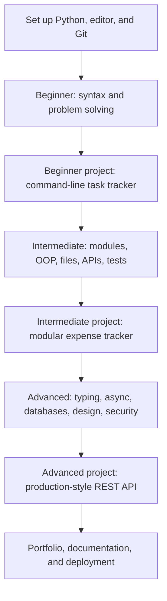
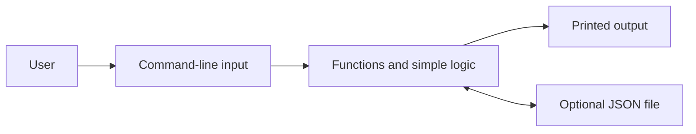
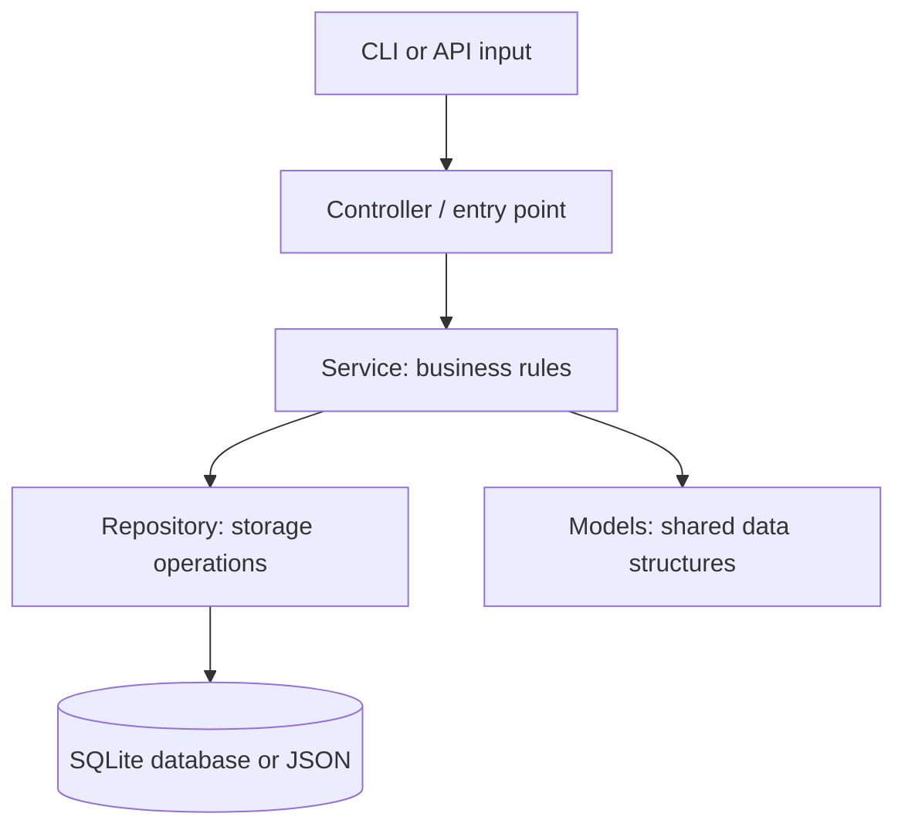
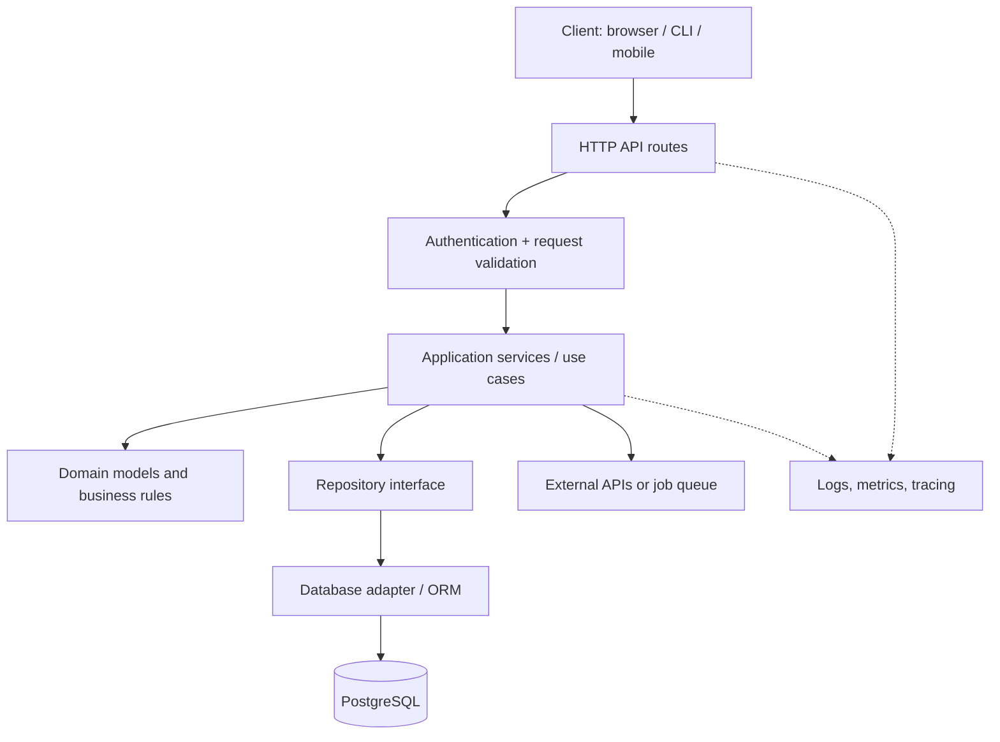
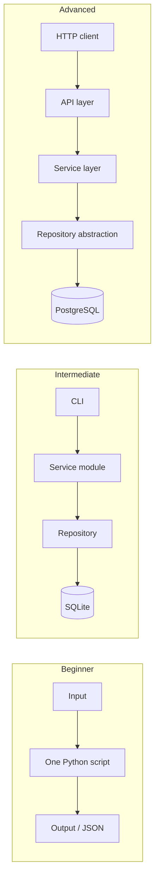

# Python Learning Roadmap: Beginner → Intermediate → Advanced

> A practical, step-by-step guide to learning Python, understanding software architecture, and building increasingly realistic applications.

## Table of Contents

1. [How to Use This Roadmap](#how-to-use-this-roadmap)
2. [Learning Architecture](#learning-architecture)
3. [Set Up Your Environment](#set-up-your-environment)
4. [Level 1 — Beginner](#level-1--beginner)
5. [Level 2 — Intermediate](#level-2--intermediate)
6. [Level 3 — Advanced](#level-3--advanced)
7. [Project Architecture Examples](#project-architecture-examples)
8. [12-Week Suggested Study Plan](#12-week-suggested-study-plan)
9. [Practice Checklist and Next Steps](#practice-checklist-and-next-steps)
10. [Learning Resources](#learning-resources)

---

## How to Use This Roadmap

Follow the topics **in order**. For each topic:

1. **Learn** the idea and read a short example.
2. **Try** the example yourself, then change it.
3. **Practice** with a small exercise without copying the solution.
4. **Build** the milestone project for that level.
5. **Review** the checklist before moving on.

**Suggested routine:** 30–60 minutes a day, 5 days a week. The schedule below is flexible; move forward when you can complete the exercises, not simply when the week ends.

**What “architecture” means here:** the way code is organized into pieces, how those pieces communicate, and how data moves through an application. You will start with simple scripts and progress toward layered, tested, and deployable applications.

## Learning Architecture



### Skills and architecture at each level

| Level | Main learning goal | Architecture style | Project outcome |
|---|---|---|---|
| Beginner | Write correct small programs | Single script with functions | CLI task tracker |
| Intermediate | Organize and test reusable code | Modules + separate data and business logic | Expense tracker with persistent storage |
| Advanced | Design reliable, maintainable systems | Layered API + services + repository/database | REST API with tests and deployment |

---

## Set Up Your Environment

**You need:** a supported Python 3 release, a code editor (such as VS Code), a terminal, and Git.

1. Install Python from <https://www.python.org/downloads/>.
2. Check your installation:

   ```bash
   python --version
   # On some systems use: python3 --version
   ```

3. Create a folder and a virtual environment:

   ```bash
   mkdir learn-python
   cd learn-python
   python -m venv .venv
   ```

4. Activate the environment:

   **macOS/Linux:**

   ```bash
   source .venv/bin/activate
   ```

   **Windows PowerShell:**

   ```powershell
   .venv\Scripts\Activate.ps1
   ```

5. Create `hello.py`:

   ```python
   print("Hello, Python!")
   ```

6. Run it:

   ```bash
   python hello.py
   ```

7. Start tracking your work with Git:

   ```bash
   git init
   echo ".venv/" >> .gitignore
   ```

> **Tip:** In Windows, `py` may work instead of `python`. On macOS/Linux, `python3` may work instead of `python`. Use the same interpreter for your virtual environment and package installs.

---

## Level 1 — Beginner

**Goal:** Become comfortable writing programs, using conditions and loops, and splitting logic into functions.

### Step-by-step topics

| Step | Topic | Learn | Practice |
|---|---|---|---|
| 1 | First program | `print()`, comments, syntax, running scripts | Print your name and three goals |
| 2 | Variables and types | `int`, `float`, `str`, `bool`, `None`, `type()` | Create a personal profile |
| 3 | Input and operators | `input()`, conversion, arithmetic, comparison, logical operators | Tip calculator |
| 4 | Conditions | `if`, `elif`, `else` | Grade checker |
| 5 | Loops | `for`, `while`, `range()`, `break`, `continue` | Number guessing game |
| 6 | Collections | Lists, tuples, sets, dictionaries | Store and search student records |
| 7 | Strings | Indexing, slicing, formatting, common methods | Word counter |
| 8 | Functions | `def`, parameters, return values, scope | Reusable calculator functions |
| 9 | Errors | Tracebacks, `try`, `except`, `finally` | Validate numerical input |
| 10 | Files | Read and write text files with `with open(...)` | Simple notes app |
| 11 | Standard library | `pathlib`, `random`, `datetime`, `json` | Save data as JSON |
| 12 | Basic debugging | Reading errors, `print()` debugging, editor debugger | Fix broken exercises |

### Small code example: functions and conditions

```python
def classify_score(score: int) -> str:
    if score >= 80:
        return "Excellent"
    if score >= 50:
        return "Pass"
    return "Try again"


score = int(input("Enter your score: "))
print(classify_score(score))
```

**Try it:** What happens if you enter a non-number? Update the program to handle `ValueError`. Then validate scores between 0 and 100.

### Beginner architecture: one script, multiple functions



**Milestone project: CLI Task Tracker**

Functions to implement:

- Add a task, view tasks, mark a task complete, and remove a task.
- Store tasks in memory first; then add JSON-file persistence.
- Handle invalid menu selections without crashing.

Suggested structure:

```text
beginner-task-tracker/
├── README.md
├── app.py
├── tasks.json        # Created when the program saves data
└── .gitignore
```

**Ready for intermediate when you can:**

- [ ] Write loops, conditions, and functions without copying examples.
- [ ] Choose the right collection for simple problems.
- [ ] Read useful error messages and fix common bugs.
- [ ] Read and write JSON or text files.
- [ ] Explain how your task tracker receives, processes, and saves data.

---

## Level 2 — Intermediate

**Goal:** Move beyond single-file scripts to modular, reusable, testable applications.

### Step-by-step topics

| Step | Topic | Learn | Practice |
|---|---|---|---|
| 1 | Modules and packages | `import`, packages, `__init__.py`, `python -m` | Split a calculator into modules |
| 2 | Virtual environments and dependencies | `venv`, `pip`, dependency files | Install and document a dependency |
| 3 | Object-oriented programming | Classes, objects, methods, encapsulation, composition | Create `Expense` and `Budget` classes |
| 4 | Data modeling | `dataclasses`, enums, validation | Model transactions consistently |
| 5 | Comprehensions and generators | List/dict comprehensions, `yield`, iterators | Process large logs one line at a time |
| 6 | Exceptions and logging | Custom exceptions, `logging` | Log recoverable failures |
| 7 | Data formats and HTTP | CSV, JSON, HTTP methods, status codes, API requests | Fetch and summarize public API data |
| 8 | Automated testing | `unittest` or `pytest`, assertions, fixtures, mocks | Test calculation and validation logic |
| 9 | Databases | SQL basics, SQLite, CRUD, parameterized queries | Save expenses in a database |
| 10 | Type hints and formatting | `typing`, type checking, PEP 8, formatter/linter | Add type hints and lint checks |
| 11 | Command-line interfaces | `argparse`, options, exit codes | Build a CLI with subcommands |
| 12 | Git collaboration basics | Commits, branches, pull requests, review | Keep project history readable |

### Small code example: data modeling

```python
from dataclasses import dataclass
from decimal import Decimal


@dataclass(frozen=True)
class Expense:
    description: str
    amount: Decimal


def total_expenses(expenses: list[Expense]) -> Decimal:
    return sum((expense.amount for expense in expenses), Decimal("0"))


items = [
    Expense("Books", Decimal("18.50")),
    Expense("Coffee", Decimal("3.20")),
]
print(total_expenses(items))  # 21.70
```

**Why `Decimal`?** It is useful for money-like decimal calculations where binary floating-point rounding can be surprising. Real financial systems also need clear currency and rounding rules.

### Intermediate architecture: separate responsibilities



**Milestone project: Expense Tracker**

Build an application that can record expenses, list them, filter by category, and calculate monthly totals. Start with JSON storage; optionally migrate to SQLite. Add input validation and tests.

Suggested structure:

```text
intermediate-expense-tracker/
├── README.md
├── pyproject.toml
├── src/
│   └── expense_tracker/
│       ├── __init__.py
│       ├── cli.py             # User interaction
│       ├── models.py          # Expense data structures
│       ├── services.py        # Calculations and business rules
│       └── repository.py      # Storage operations
├── tests/
│   ├── test_services.py
│   └── test_repository.py
└── .gitignore
```

**Important design rule:** Avoid putting `input()`, SQL, and calculations all inside one function. Keep business rules independent of input/output where possible.

**Ready for advanced when you can:**

- [ ] Explain classes versus functions and when to use each.
- [ ] Organize a project into importable modules.
- [ ] Write unit tests for happy paths and error cases.
- [ ] Save and retrieve data with SQL or another persistent store.
- [ ] Use logging, validation, typing, and dependency isolation.
- [ ] Describe controller, service, and repository responsibilities.

---

## Level 3 — Advanced

**Goal:** Build maintainable, secure, observable, and deployable Python services; understand trade-offs rather than just syntax.

### Step-by-step topics

| Step | Topic | Learn | Practice |
|---|---|---|---|
| 1 | Advanced Python behavior | Decorators, context managers, descriptors, dunder methods | Write a timing decorator and context manager |
| 2 | Type-safe design | Protocols, generics, type narrowing, static analysis | Type-check a service/repository boundary |
| 3 | Concurrency | Threads, processes, GIL concepts, I/O vs CPU workloads | Compare approaches for I/O tasks |
| 4 | Asynchronous Python | `async`, `await`, `asyncio`, cancellation, timeouts | Concurrently request multiple endpoints |
| 5 | API development | FastAPI or similar, REST patterns, validation, pagination | Implement CRUD endpoints |
| 6 | Data persistence | Transactions, indexes, schema migrations, connection pooling | Use PostgreSQL and migrations |
| 7 | Architecture patterns | Dependency injection, layered architecture, repositories, boundaries | Swap storage without changing business logic |
| 8 | Security fundamentals | Secrets, authentication, authorization, input validation, safe SQL | Protect selected endpoints and enforce permissions |
| 9 | Performance | Profiling, caching, query plans, load testing | Find a bottleneck before optimizing |
| 10 | Reliability | Retries with backoff, idempotency, timeouts, queues | Design a resilient background job |
| 11 | Testing strategies | Integration tests, contract tests, test doubles, coverage | Test API + database together |
| 12 | Delivery and operations | Docker, CI/CD, configuration, structured logs, metrics, deployment | Containerize and deploy a small service |

### Small code example: asynchronous I/O

```python
import asyncio


async def simulated_request(name: str, delay: float) -> str:
    await asyncio.sleep(delay)  # Simulates waiting for I/O
    return f"Finished {name}"


async def main() -> None:
    results = await asyncio.gather(
        simulated_request("A", 1),
        simulated_request("B", 1),
    )
    print(results)


if __name__ == "__main__":
    asyncio.run(main())
```

**Remember:** Async code helps with many waiting/I/O workloads; it does not automatically make CPU-heavy code faster. Choose threads, processes, or async based on the actual workload and measurements.

### Advanced architecture: layered web service



**Milestone project: Task Management REST API**

Build a backend service with task creation, updates, assignment, and status tracking. Use a Python web framework, a relational database, tests, and containerized local development.

Suggested structure:

```text
advanced-task-api/
├── README.md
├── pyproject.toml
├── Dockerfile
├── .env.example              # Names only; never real secrets
├── src/
│   └── task_api/
│       ├── __init__.py
│       ├── main.py           # App initialization
│       ├── api/
│       │   ├── routes.py     # HTTP endpoints
│       │   └── schemas.py    # Request/response schemas
│       ├── domain/
│       │   └── models.py     # Domain entities and rules
│       ├── services/
│       │   └── tasks.py      # Use cases
│       ├── repositories/
│       │   ├── base.py       # Storage abstraction
│       │   └── postgres.py   # Database implementation
│       └── core/
│           └── config.py     # Configuration
├── migrations/
└── tests/
    ├── unit/
    └── integration/
```

**Suggested delivery sequence:**

1. Define task fields and business rules.
2. Implement a service using an in-memory repository.
3. Add unit tests around the service.
4. Implement API routes and request validation.
5. Add PostgreSQL storage and schema migrations.
6. Add authentication and authorization appropriate to the use case.
7. Write integration tests using an isolated test database.
8. Add configuration, logging, health checks, and a Dockerfile.
9. Run automated tests in CI and deploy to a suitable host.
10. Document architecture decisions, API usage, and known limitations.

**Ready for real-world team projects when you can:**

- [ ] Explain trade-offs of synchronous, threaded, multiprocess, and async execution.
- [ ] Separate HTTP concerns, business logic, and persistence.
- [ ] Test failure paths, permissions, and database interactions.
- [ ] Keep credentials out of source code and validate untrusted input.
- [ ] Profile performance instead of optimizing by guesswork.
- [ ] Package, run, monitor, and troubleshoot a deployed service.

---

## Project Architecture Examples

The architecture grows with the scale of the problem:



### How to choose an architecture

| Question | Beginner approach | More mature approach |
|---|---|---|
| Where does input come from? | `input()` | CLI parser / HTTP endpoint |
| Where do rules live? | Functions in one file | Dedicated service/domain layer |
| How is data saved? | JSON file | Repository with SQL database |
| How do you verify behavior? | Manual runs | Automated unit + integration tests |
| How are problems diagnosed? | Print statements | Logs, metrics, tracing |
| How is software delivered? | `python app.py` | Packages, containers, CI/CD |

> **Avoid premature complexity:** Beginners do not need microservices, Kubernetes, or distributed systems to build useful Python applications. Good architecture means having enough structure for the current problem, not the most layers possible.

---

## 12-Week Suggested Study Plan

This is an **accelerated overview**, not a promise of mastery. Spend more time on topics that are unfamiliar, especially testing, SQL, and async programming.

| Week | Focus | Deliverable |
|---|---|---|
| 1 | Setup, variables, types, input, conditions | Calculator + grade checker |
| 2 | Loops, collections, strings, functions | Quiz game |
| 3 | Exceptions, files, JSON, debugging | Beginner task tracker |
| 4 | Modules, packages, environments, OOP | Refactor a project into modules |
| 5 | Dataclasses, comprehensions, logging, HTTP | API data summarizer |
| 6 | Testing, SQL, typing, CLI | Intermediate expense tracker |
| 7 | Decorators, context managers, typing patterns | Utility library with tests |
| 8 | Threads, processes, `asyncio` | Concurrency experiments |
| 9 | REST API development and validation | CRUD API with in-memory storage |
| 10 | Database integration, migration, architecture | API backed by PostgreSQL |
| 11 | Security, integration tests, performance | Tested, validated endpoints |
| 12 | Docker, CI, logging, deployment | Documented portfolio-ready API |

### Example weekly learning cycle

- **Day 1:** Learn the core concepts and run examples.
- **Day 2:** Solve 3–5 small exercises.
- **Day 3:** Build one feature.
- **Day 4:** Test, debug, and refactor.
- **Day 5:** Document what you learned and commit your work.

---

## Practice Checklist and Next Steps

Use this checklist for **every** project:

- [ ] Write a README that explains what the project does.
- [ ] List setup steps and example commands.
- [ ] Handle invalid inputs and expected failures.
- [ ] Keep code readable and avoid duplication.
- [ ] Add tests appropriate to the project's level.
- [ ] Add a `.gitignore` and exclude `.venv/`, local databases if sensitive, and secrets.
- [ ] Save meaningful Git commits.
- [ ] Explain the architecture and data flow in a few sentences.
- [ ] Record what you would improve next.

### Optional specializations after the core roadmap

Choose **one track** based on your goals:

- **Backend engineering:** REST APIs, databases, caching, authentication, observability, distributed systems.
- **Data science:** NumPy, pandas, visualization, statistics, notebooks, machine learning.
- **Automation / DevOps:** `pathlib`, subprocesses, HTTP APIs, scripting, cloud SDKs, CI pipelines.
- **AI engineering:** data preparation, model APIs, evaluation, retrieval, safety, and serving.
- **Testing / quality engineering:** pytest, property-based testing, automation, performance and security testing.

## Learning Resources

- [Official Python Tutorial](https://docs.python.org/3/tutorial/) — language fundamentals.
- [Python Standard Library](https://docs.python.org/3/library/) — built-in tools and modules.
- [Python Packaging User Guide](https://packaging.python.org/) — environments, packages, publishing.
- [PEP 8](https://peps.python.org/pep-0008/) — Python code style.
- [pytest Documentation](https://docs.pytest.org/) — automated tests.
- [FastAPI Documentation](https://fastapi.tiangolo.com/) — web APIs (optional advanced framework).
- [PostgreSQL Documentation](https://www.postgresql.org/docs/) — relational databases.

---

**Final advice:** Write code every day you study. Build one complete project per level, and be able to explain *why* you organized the code that way. A working, well-tested small application teaches more than a complex architecture copied without understanding it.
